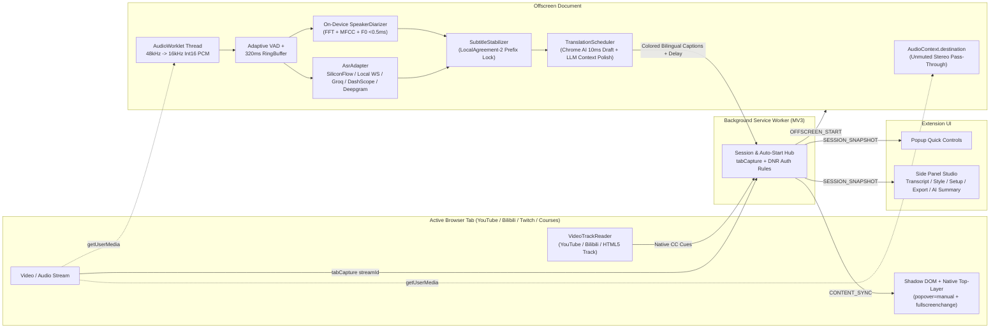

<div align="center">
  
  <h1>EchoSub</h1>
  <p><strong>Real-Time Browser Tab Audio &amp; Video to Cinematic Bilingual Subtitles for Chrome &amp; Edge</strong></p>
  <p>
    <strong>English</strong> ·
    <a href="./README.zh-CN.md">简体中文</a> ·
    <a href="#quick-start">Quick Start</a> ·
    <a href="#free-setup-recipes">Free Recipes</a> ·
    <a href="#architecture">Architecture</a> ·
    <a href="./docs/LOCAL_WS_PROTOCOL.md">Local Offline Protocol</a> ·
    <a href="./docs/INTERVIEW_GUIDE.md">Architecture Deep Dive</a>
  </p>
  <p>
    <a href="https://github.com/DuskstarXiao/echosub/releases"></a>
    
    
    
    
    
    
  </p>
</div>

---

## What is EchoSub?

**EchoSub** turns any unsubtitled foreign video, overseas livestream (**YouTube / Twitch / Bilibili**), online course (**Coursera / Udemy**), or browser meeting into **cinematic frosted-glass bilingual subtitles** — with **zero audio muting**, **true fullscreen Top-Layer rendering**, **on-device multi-speaker voiceprint coloring**, **live bilingual transcript timeline**, **`.srt` / `.md` export**, and **AI structured study summaries**.

Unlike traditional subtitle extensions that force 500MB browser-side Whisper downloads (with 5s latency & hallucinations), mute your tab audio, or vanish whenever you hit fullscreen, EchoSub is engineered from the ground up around **Chrome Manifest V3 best practices** and **pluggable zero-cost / cloud / local offline adapters**.

---

## Why EchoSub?

| Pain Point | Typical Subtitle Extensions | **EchoSub** |
| --- | --- | --- |
| **Tab audio during capture** | Often mutes video or causes echo | **Direct `AudioContext.destination` pass-through** (0ms echo, pristine stereo) |
| **True Fullscreen video** | Overlay disappears behind `<video>` | **Shadow DOM + Native Top-Layer (`popover="manual"`) + `fullscreenchange` reparenting** |
| **Streaming caption flicker** | Whole sentence jumps & rewrites wildly | **LocalAgreement-2 Stable Prefix Locking** + **Mode A / Mode B Dual Timing** |
| **Multi-speaker dialogue** | Everyone blends into one color | **On-device FFT + MFCC + F0 Voiceprint Diarization** (`<0.5ms`, $0 cost, 5 colors) |
| **Cost & network barrier** | Requires overseas credit card / paid SaaS | **SiliconFlow Free All-in-One**, **Chrome 138+ Built-in Offline AI**, **1-Click Local Offline Server**, **Groq Free Tier** |
| **Videos that already have CC** | Still burns paid ASR tokens | **Smart Hybrid Routing** (auto-translates native tracks at $0 ASR cost; falls back to audio on raw videos) |

---

## Core Features

### 1. Non-Muting MV3 Audio Pipeline & Smart Hybrid Routing
- **Standard MV3 Capture Chain**: `Service Worker` (`tabCapture.getMediaStreamId`) → `Offscreen Document` (`getUserMedia` → direct `AudioContext.destination` playback + parallel `AudioWorklet` off-main-thread 48kHz→16kHz Int16 PCM resampling & 0-Gain anti-pruning sink).
- **Adaptive Energy + ZCR VAD & 320ms Pre-Roll RingBuffer**: Filters silence and pure background music to cut cloud ASR bills by ~40% while never clipping initial consonants.
- **Smart Hybrid Routing (`Auto` / `Audio ASR` / `Track Only`)**: Automatically reads native caption tracks on YouTube, Bilibili, and HTML5 `<video>` courses (skipping tracks already in your target language!) at **$0 ASR cost**, seamlessly switching to live tab audio ASR on unsubtitled videos, livestreams, and meetings.
- **Auto-Start on Checked Video Sites**: Enable automatic launch on YouTube, Bilibili, Twitch, Coursera, Udemy, TED/Vimeo, or custom domains (SPA-navigation aware).

### 2. Dual Subtitle Timing Modes & Delay Badge
Switch instantaneously between two viewing styles in the Popup or Side Panel:
- **Mode A · Low-Latency Streaming**: Tight VAD hangover (`320ms`), fast rolling ASR cadence (`~720ms`), and **~10ms Chrome 138+ Built-in On-Device AI interim drafts** upgraded to LLM polish on sentence end.
- **Mode B · Complete-Sentence Translation**: Zero word-by-word fragment jitter — waits for a full spoken sentence, translates it cleanly in one contextual pass, and renders source + translation together like cinema subtitles (~70% fewer API calls).
- **Optional Delay Tag (`[2.3s ago]`)**: Check one box to display the true elapsed time from when the speaker began the utterance to when the translated caption appeared.

### 3. Zero-Cost On-Device Multi-Speaker Timbre Coloring
- Extracts **10-dim energy-invariant MFCC vocal-tract features (512-pt Radix-2 FFT + 12-band Mel filterbank)** + **first-peak autocorrelation pitch (`F0`)** + **spectral centroid** directly from captured 16kHz PCM in `<0.5ms`.
- Automatically clusters distinct speakers into high-contrast cinematic role themes (**Speaker A–E**: Cyan, Amber, Rose, Violet, Emerald) with glowing role pills, left accent bars, a live **Split Sensitivity slider**, and a 1-click **Reset Voices** button.

### 4. Fullscreen-Proof Cinematic Overlay & Side Panel Studio
- **Drag-anywhere glassmorphism pill** isolated in **Shadow DOM** + promoted into the browser's **Top Layer (`popover="manual"`)** — stays rock-solid above YouTube, Bilibili, Twitch, and native `<video>` fullscreen.
- **Appearance Studio**: Live preview + real-time sliders for font size, frosted opacity, backdrop blur, max width, line order, accent colors, and hiding duplicate native CC.
- **Side Panel Workspace**: Real-time 24-bar audio waveform & VAD monitor, searchable timestamped bilingual transcript, 1-click **`.srt` subtitle** & **`.md` study note** export, **AI Structured Summary**, and built-in **1-Click Connection Diagnostics**.

---

## Architecture



### MV3 Non-Muting Audio & Dual-Mode Pipeline Sequence

```mermaid
sequenceDiagram
  participant User
  participant SW as Service Worker
  participant Off as Offscreen Document
  participant AW as AudioWorklet Thread
  participant ASR as ASR + Diarizer
  participant TR as Translator Queue
  participant CS as Content Script (Top-Layer)

  User->>SW: Click "Start Live Subtitles" (or Alt+Shift+S)
  SW->>SW: chrome.tabCapture.getMediaStreamId(tabId)
  SW->>Off: Close stale Offscreen & launch fresh OFFSCREEN_START
  Off->>Off: getUserMedia(tab) -> direct AudioContext.destination (Unmuted!)
  Off->>AW: Attach pcm-processor.js via 0-gain sink (Zero Echo, No Pruning)
  loop Every 40ms (640 samples @ 16kHz)
    AW-->>Off: Transfer Int16 PCM ArrayBuffer + RMS / ZCR / 24-bin Waveform
    Off->>ASR: Stream voiced PCM (+320ms pre-roll) & extract MFCC+F0 voiceprint
    ASR-->>Off: Partial / Final text + Speaker A..E role
    Off->>TR: Mode A (10ms Chrome AI draft -> LLM final) or Mode B (Full sentence once)
    TR-->>SW: Stabilized colored bilingual cue + [x.xs ago] delay
    SW-->>CS: Render in Shadow DOM Top-Layer above fullscreen video
  end
```

---

## Free Setup Recipes

EchoSub includes a **30-Second Guided Setup Wizard** and a **1-Click Connection Tester** inside **Side Panel → Setup**:

| Recipe | ASR Engine | Translation Engine | Cost | Network |
| --- | --- | --- | --- | --- |
| **All-in-One Free Cloud (1 Key)** | SiliconFlow `FunAudioLLM/SenseVoiceSmall` | SiliconFlow `Qwen2.5-7B-Instruct` | **$0 Free Tier** | China Direct & Global |
| **100% Local Offline (Zero Key)** | Included [`local-asr/`](./local-asr/README.md) (`faster-whisper`) | Chrome 138+ Built-in AI (`self.Translator`) | **$0 Forever Offline** | Zero Internet Needed |
| **Global Fast Free Tier** | Groq `whisper-large-v3-turbo` | Chrome Built-in AI / Auto Free Failover | **Generous Free Quota** | Global |
| **Enterprise / Streaming** | Aliyun DashScope Paraformer / Deepgram Nova-2 | Tencent TMT (5M free/mo) / Zhipu GLM-4-Flash / DeepSeek / Ollama | Free Quota / BYOK | Direct / Global |
| **Zero-Key Demo Mode** | Built-in Streaming Demo | Built-in Instant Dictionary | **$0 / Zero Config** | Offline |

---

## Quick Start

### 1. Download Prebuilt Package (Fastest) or Build from Source

- **Prebuilt**: Download `echosub-1.0.0-chrome.zip` (or `echosub-1.0.0-edge.zip`) from [**GitHub Releases**](https://github.com/DuskstarXiao/echosub/releases), unzip, and load in Chrome/Edge.
- **From Source**:

```bash
git clone https://github.com/DuskstarXiao/echosub.git
cd echosub
npm install
npm run build        # Chrome MV3 -> .output/chrome-mv3
npm run build:edge   # Edge MV3   -> .output/edge-mv3
```

### 2. Load into Chrome or Edge

1. Navigate to `chrome://extensions` (or `edge://extensions`).
2. Toggle **Developer mode** ON.
3. Click **Load unpacked** and select `.output/chrome-mv3` (or `.output/edge-mv3`).
4. Open any video on YouTube / Bilibili / Twitch, click the **EchoSub** icon, and hit **Start Live Subtitles** (or press `Alt + Shift + S`).

### 3. Optional: Launch 100% Offline Local ASR (Zero Cloud Cost)

- **Windows**: Double-click [`local-asr/一键启动本地语音引擎.bat`](./local-asr/一键启动本地语音引擎.bat)
- **macOS / Linux**: Run `./local-asr/start-local-asr.sh`
- Select **100% Local Offline** in EchoSub **Side Panel → Setup** and click **Test ASR & Translation**.

### Keyboard Shortcuts

| Shortcut (Win/Linux) | Shortcut (macOS) | Action |
| --- | --- | --- |
| `Alt + Shift + S` | `Ctrl + Shift + S` | Start / Stop live subtitle capture |
| `Alt + Shift + H` | `Ctrl + Shift + H` | Show / Hide floating subtitle overlay |

---

## Development & Testing

```bash
npm run dev          # Start WXT HMR development mode for Chrome
npm run dev:edge     # Start WXT HMR development mode for Edge
npm run typecheck    # Strict TypeScript check (tsc --noEmit)
npm test             # Run all 34 Vitest unit tests (DSP, VAD, Diarizer, Stabilizer, Queue, Exporter, Site Matcher)
npm run zip          # Package Chrome Web Store production zip
npm run zip:edge     # Package Edge Add-ons production zip
```

---

## Project Structure

```text
echosub/
├── .github/workflows/ci.yml   # Automated CI: typecheck + Vitest + Chrome/Edge zip artifacts
├── docs/
│   ├── LOCAL_WS_PROTOCOL.md   # Unified WebSocket ASR protocol (echosub-v1 & WhisperLiveKit compat)
│   └── INTERVIEW_GUIDE.md     # Full architectural deep dive & technical Q&A (CN)
├── local-asr/                 # Ready-to-run offline faster-whisper server + Win/Mac/Linux launchers
├── public/
│   ├── icon/                  # Crisp generated brand icons (16 / 32 / 48 / 128px)
│   └── worklets/
│       └── pcm-processor.js   # MV3 CSP-compliant AudioWorkletProcessor (48kHz -> 16kHz PCM)
├── src/
│   ├── core/                  # Pure TypeScript domain logic (0 chrome.* deps, 100% unit-tested)
│   │   ├── audio/             # Resampler, WAV encoder, adaptive VAD, RingBuffer, SpeakerDiarizer
│   │   ├── asr/               # Adapter pattern: SiliconFlow, Groq, DashScope, Deepgram, Local WS, Demo
│   │   ├── translator/        # Chrome Built-in AI, Tencent TMT (Web Crypto TC3), LLM & AI Summarizer
│   │   ├── subtitle/          # LocalAgreement-2 stabilizer, Mode A/B translation queue, SRT/MD exporter
│   │   ├── sites/             # Auto-start video site & SPA URL matcher
│   │   ├── diagnostics/       # Parallel ASR + Translator live latency tester
│   │   └── i18n/              # Auto-detected zh-CN & en-US dictionaries
│   └── entrypoints/
│       ├── background.ts      # MV3 Service Worker: tabCapture, auto-start, DNR WS auth, message hub
│       ├── offscreen/         # Non-muting Web Audio graph + AudioWorklet + streaming pipeline
│       ├── content/           # Shadow DOM + Top-Layer overlay + YouTube/Bilibili/HTML5 TrackReader
│       ├── popup/             # Quick controls: Mode A/B, Hybrid mode, waveform, auto-start toggle
│       └── sidepanel/         # Studio UI: Transcript, Appearance Studio, Guided Setup, Export & AI Summary
└── tests/                     # 9 Vitest suites (34 unit tests)
```

---

## Roadmap

- [x] Non-muting MV3 `tabCapture` → `Offscreen` → `AudioWorklet` 16kHz PCM pipeline
- [x] Shadow DOM + native Top-Layer (`popover="manual"`) fullscreen overlay
- [x] Multi-provider ASR & Translation Adapters (SiliconFlow, Groq, DashScope, Deepgram, Local WS, Chrome AI, Tencent TMT, DeepSeek)
- [x] On-device acoustic multi-speaker timbre coloring (`SpeakerDiarizer`)
- [x] Mode A (Low-Latency) & Mode B (Full-Sentence) + `[x.xs ago]` delay badge
- [x] Smart Hybrid Subtitle Track routing + Auto-Start on checked video sites
- [ ] Custom speaker name editing & exportable bilingual ASS/VTT formats
- [ ] Local SenseVoice / Sherpa-ONNX ONNX Runtime preset inside `local-asr/`
- [ ] Chrome Web Store & Edge Add-ons store listing

---

## Contributing & License

Pull requests, issue reports, and new ASR/Translator adapters are warmly welcome!

Licensed under the [MIT License](./LICENSE).
