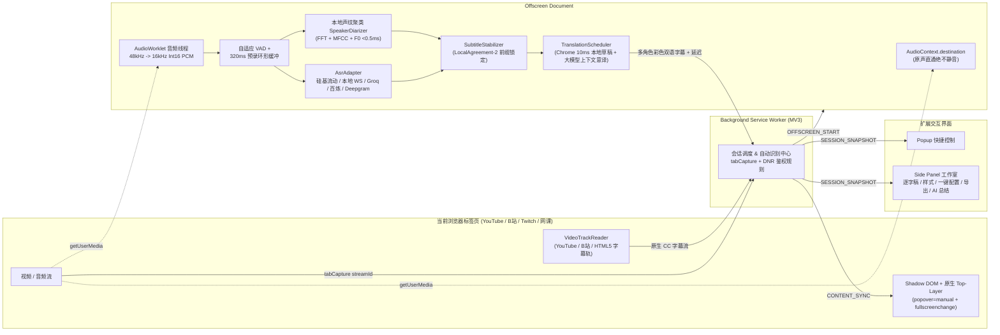

<div align="center">
  
  <h1>EchoSub</h1>
  <p><strong>Chrome / Edge 实时视频音频转电影级双语字幕浏览器扩展</strong></p>
  <p>
    <a href="./README.md">English</a> ·
    <strong>简体中文</strong> ·
    <a href="#快速上手3-步安装">快速上手</a> ·
    <a href="#30-秒免费配置方案">免费方案</a> ·
    <a href="#系统架构">系统架构</a> ·
    <a href="./docs/LOCAL_WS_PROTOCOL.md">本地离线协议</a> ·
    <a href="./docs/INTERVIEW_GUIDE.md">原理与面试指南</a>
  </p>
  <p>
    <a href="https://github.com/DuskstarXiao/echosub/releases"></a>
    
    
    
    
    
    
  </p>
</div>

---

## 项目简介

**EchoSub** 是一款面向 **外语无字幕生肉视频、海外直播（YouTube / Twitch / B站）、外语网课（Coursera / Udemy）与浏览器在线会议** 的开源实时双语字幕扩展。

点击开启即可在不静音原视频的前提下，在视频画面上渲染**电影级磨砂双语字幕**——原生支持**真全屏置顶不遮挡**、**本地零费用多角色音色分色**、**极速实时 / 整句精翻双模式切换**、**勾选视频网站自动开启**、侧边栏完整逐字稿、一键导出 `.srt` / `.md` 与 **AI 重点总结**。

---

## 为什么选择 EchoSub？（痛点直击对比）

| 常见痛点 | 普通字幕插件 | **EchoSub** |
| --- | --- | --- |
| **捕获音频时视频静音/回声** | 开启后常静音或出现双声延迟 | **`AudioContext.destination` 原声直通 + 0-Gain 防裁剪架构**（零回声、原音质） |
| **视频全屏后字幕消失** | 普通 `z-index` 被全屏层遮挡 | **Shadow DOM + 浏览器原生 Top-Layer (`popover="manual"`) + `fullscreenchange` 重挂载** |
| **流式字幕疯狂闪烁重排** | 边说边改、跳来跳去眼睛累 | **LocalAgreement-2 稳定前缀锁定** + **模式 A 极速实时 / 模式 B 整句精翻** |
| **多人对话角色分不清** | 所有人挤在同一颜色字幕里 | **纯前端 FFT + MFCC + F0 实时声纹聚类**（`<0.5ms`、¥0 费用、5 色电影级分色） |
| **国内网络与费用门槛** | 强依赖海外绑卡或下载 500MB 浏览器模型 | **硅基流动 1 个免费 Key 全家桶**、**Chrome 138+ 本地离线机翻**、**一键本地离线语音包** |
| **有自带字幕轨仍烧识别费** | 全部走语音识别浪费额度 | **智能混合路由**（自带外语 CC 轨 0 费用直译，无字幕生肉/直播无缝切音频转写） |

---

## 核心特性

### 1. MV3 不断声音频管线 + 智能双模式混合路由
- **MV3 标准音频捕获**：`Service Worker` 申请 `tabCapture` → `Offscreen Document` 接管媒体流并直通 `AudioContext.destination` 放音 → 独立音频线程 `AudioWorklet` 实时重采样为 `16kHz Int16 PCM` + 自适应能量/过零率 VAD（带 `320ms` 预录环形缓冲防吞首字）。
- **智能混合模式（`智能混合` / `音频转写` / `字幕轨直译`）**：自动识别 YouTube / B站 / HTML5 `<video>` 自带的外语字幕轨（并自动跳过已经是中文的 AI 字幕轨防止重复），有轨时 0 费用直译并隐藏原播放器小字幕，无字幕生肉/直播无缝切实时语音转写。
- **视频网站自动开启**：可自由勾选 YouTube / B站 / Twitch / Coursera / Udemy / TED & Vimeo 或添加任意自定义域名（如 `netflix.com`、`zoom.us`），智能跳过首页只匹配视频/直播播放页（兼容 SPA 站内切集）。

### 2. 双字幕节奏模式 + 延迟标注
弹窗与侧边栏均支持一键实时热切换：
- **⚡ 模式 A · 极速实时**（适合直播 / 会议）：收紧 VAD 停顿等待（`320ms`）与快速切片（`~720ms`），当浏览器支持 **Chrome 138+ 内置本地离线翻译** 时，说话中途直接用 **~10ms 本地翻译秒出草稿**、句末再用大模型精翻替换。
- **🎬 模式 B · 整句精翻**（适合录播 / 网课 / 访谈）：彻底屏蔽几个字几个字的跳变，**等说完完整一句后再整句一次性翻译**，原文与译文同步呈现，语序最顺滑且节省约 70% API 调用。
- **延迟标注开关**：勾选 **「显示延迟 [s前]」** 后，每句译文末尾会以淡色等宽字显示该句距离原话开口的真实延迟（如 `[2.3s前]`），轻松对齐画面。

### 3. 本地零费用多角色音色分色字幕
- 直接复用已采集的 `16kHz PCM` 人声缓冲，在本地完成 **512 点基-2 FFT → 12 频带梅尔倒谱 MFCC（音量无关声道共振峰）+ 首主峰自相关基频 F0 + 频谱质心** 提取（单句 `<0.5ms`）。
- 自动区分最多 5 个不同说话人（`角色 A` 青碧 / `角色 B` 琥珀金 / `角色 C` 樱花粉 / `角色 D` 丁香紫 / `角色 E` 翡翠绿），配套**高对比度实体彩色角色徽章 + 发光左边框 + 音色分色灵敏度滑块 + 一键重置声纹**。

### 4. 电影级全屏浮层 + 侧边栏工作室
- **Shadow DOM 样式隔离 + 原生 Top-Layer (`popover="manual"`)**：支持鼠标任意拖拽定位、悬停浮现快捷控制栏，在 YouTube / B站 / Twitch 网页全屏与系统真全屏下始终稳居最顶层。
- **完整侧边栏工作室**：实时 24 柱音频波形与 VAD 仪表盘、带时间戳和角色标签的双语逐字稿、外观工作室实时预览、一键导出标准 **`.srt` 字幕** 与 **`.md` 学习笔记**、一键生成 **AI 重点总结**、以及 **一键测通语音 & 翻译** 实时诊断。

---

## 系统架构



---

## 30 秒免费配置方案

在侧边栏 **「一键配置」** 中直接点选对应方案卡片，并点 **「一键测通语音 & 翻译」** 即可立刻确认连通与延迟：

| 推荐方案 | 语音识别 (ASR) | 字幕翻译 | 费用 | 网络要求 |
| --- | --- | --- | --- | --- |
| **🟢 国内免费全家桶（1 个 Key）** | 硅基流动 `FunAudioLLM/SenseVoiceSmall` | 硅基流动 `Qwen2.5-7B-Instruct` | **¥0 免费模型**（实名激活即可） | 国内直连 |
| **🟣 纯本地永久免费（零账号）** | 内置 [`local-asr/`](./local-asr/README.md)（双击启动） | Chrome 138+ 内置本地离线机翻 | **永久 ¥0 离线** | 无需联网 |
| **🔵 海外高速免费方案** | Groq `whisper-large-v3-turbo` | Chrome 本地机翻 / 免费兜底 | **每日高额免费**（免绑卡） | 需代理 |
| **⚪ 进阶专业自定义** | 阿里云百炼 Paraformer / Deepgram Nova-2 | 腾讯翻译君（月免 500 万字符）/ 智谱 GLM-4-Flash / DeepSeek / Ollama | 免费额度 / BYOK | 按引擎自选 |
| **🟡 免 Key 体验预览** | 内置演示流 | 内置离线译文 | **零配置 3 秒预览** | 离线可用 |

---

## 快速上手（3 步安装）

### 第 1 步：直接下载成品包（推荐）或源码构建

- **免构建直接用**：前往 [**GitHub Releases**](https://github.com/DuskstarXiao/echosub/releases) 下载 `echosub-1.0.0-chrome.zip`（Edge 下载 `echosub-1.0.0-edge.zip`）并解压。
- **源码构建**：

```bash
git clone https://github.com/DuskstarXiao/echosub.git
cd echosub
npm install
npm run build        # 构建 Chrome MV3 扩展 -> .output/chrome-mv3
npm run build:edge   # 构建 Edge MV3 扩展   -> .output/edge-mv3
```

### 第 2 步：加载到 Chrome 或 Edge

1. 在浏览器地址栏输入 `chrome://extensions`（Edge 输入 `edge://extensions`）并回车。
2. 打开右上角 **「开发者模式」** 开关。
3. 点击 **「加载已解压的扩展程序」**，选择项目中的 `.output/chrome-mv3`（Edge 选 `.output/edge-mv3`）。

### 第 3 步：一键体验（支持纯本地零 Key）

1. 打开任意视频网页（YouTube / B站 / Twitch 等）并播放视频。
2. 点击右上角 **EchoSub** 图标 → **「开启实时字幕」**（或快捷键 `Alt + Shift + S`）。
3. 如想彻底离线零账号使用：
   - **Windows**：直接双击 [`local-asr/一键启动本地语音引擎.bat`](./local-asr/一键启动本地语音引擎.bat)（已内置清华 PyPI 源 + `hf-mirror.com` 国内模型镜像加速，普通笔记本纯 CPU 即可运行）。
   - **macOS / Linux**：运行 `./local-asr/start-local-asr.sh`。

### 常用快捷键

| 快捷键 (Windows / Linux) | 快捷键 (macOS) | 功能 |
| --- | --- | --- |
| `Alt + Shift + S` | `Ctrl + Shift + S` | 开启 / 停止实时双语字幕 |
| `Alt + Shift + H` | `Ctrl + Shift + H` | 显示 / 隐藏画面字幕浮层 |

---

## 开发与测试命令

```bash
npm run dev          # 启动 Chrome 热更新开发模式
npm run dev:edge     # 启动 Edge 热更新开发模式
npm run typecheck    # TypeScript 严格模式类型检查
npm test             # 运行全部 34 项 Vitest 核心单元测试
npm run zip          # 打包可上架 Chrome Web Store 的 .zip 产物
npm run zip:edge     # 打包可上架 Edge Add-ons 的 .zip 产物
```

---

## 工程目录结构

```text
echosub/
├── .github/workflows/ci.yml   # GitHub Actions CI：类型检查 + 单测 + Chrome/Edge 双端打包
├── docs/
│   ├── LOCAL_WS_PROTOCOL.md   # 统一本地离线 WebSocket 语音协议（兼容 WhisperLiveKit）
│   └── INTERVIEW_GUIDE.md     # 核心架构原理拆解 & 前端/音频工程面试高频 10 问 Q&A
├── local-asr/                 # 开箱即用的本地离线 faster-whisper 服务与一键启动脚本
├── public/
│   ├── icon/                  # 品牌图标集（16 / 32 / 48 / 128px）
│   └── worklets/
│       └── pcm-processor.js   # 符合 MV3 CSP 规范的 AudioWorklet 重采样音频处理器
├── src/
│   ├── core/                  # 纯 TypeScript 核心业务层（零 chrome.* 依赖，100% 可单测）
│   │   ├── audio/             # 重采样、WAV 编码、自适应 VAD、环形缓冲、SpeakerDiarizer 声纹聚类
│   │   ├── asr/               # Adapter 策略模式：硅基流动、Groq、百炼、Deepgram、本地 WS、演示流
│   │   ├── translator/        # Chrome 内置离线机翻、腾讯翻译君 TC3 签名、大模型上下文意译与总结
│   │   ├── subtitle/          # LocalAgreement-2 防闪烁状态机、模式 A/B 队列、SRT/MD 导出
│   │   ├── sites/             # 视频网站自动开启 URL 匹配器（支持 SPA 切集）
│   │   ├── diagnostics/       # 语音 + 翻译双链路一键测通诊断
│   │   └── i18n/              # 自动跟随浏览器语言的中英双语词典
│   └── entrypoints/
│       ├── background.ts      # MV3 Service Worker：音频授权、自动开启、DNR 规则、消息中枢
│       ├── offscreen/         # 原声直通 Web Audio 图 + AudioWorklet + 流式管线
│       ├── content/           # Shadow DOM + Top-Layer 浮层 + 视频字幕轨读取器
│       ├── popup/             # 快捷启动弹窗（模式 A/B、混合模式、实时波形、自动开启开关）
│       └── sidepanel/         # 完整工作室（逐字稿、样式预览、一键免费向导、导出与 AI 总结）
└── tests/                     # 9 个 Vitest 测试套件（共 34 项核心单测）
```

---

## Roadmap

- [x] MV3 不断声 `tabCapture` → `Offscreen` → `AudioWorklet` 16kHz PCM 管线
- [x] Shadow DOM + 原生 Top-Layer (`popover="manual"`) 真全屏可拖拽浮层
- [x] 多引擎解耦适配（硅基流动免费全家桶、本地离线包、Chrome 138+ 内置机翻、腾讯翻译君、Groq、阿里云百炼、Deepgram、DeepSeek）
- [x] 本地实时多角色声纹分色（FFT + MFCC + F0，支持灵敏度实时微调）
- [x] 模式 A（极速实时）与模式 B（整句精翻）双模式 + `[x.xs前]` 延迟标注
- [x] 智能混合字幕轨直译 + 勾选视频网站自动开启
- [ ] 支持自定义编辑说话人名称 & 导出 `.vtt` / `.ass` 样式字幕
- [ ] 在 `local-asr/` 中增加 SenseVoice / Sherpa-ONNX 引擎预设
- [ ] 上架 Chrome Web Store 与 Microsoft Edge Add-ons

---

## 欢迎贡献与开源协议

欢迎提交 Issue / PR，一起添加更多 ASR / 翻译引擎适配或播放器优化！如果这个项目帮到了你，欢迎点一颗 **Star** 支持！

本项目采用 [MIT License](./LICENSE) 开源协议。
